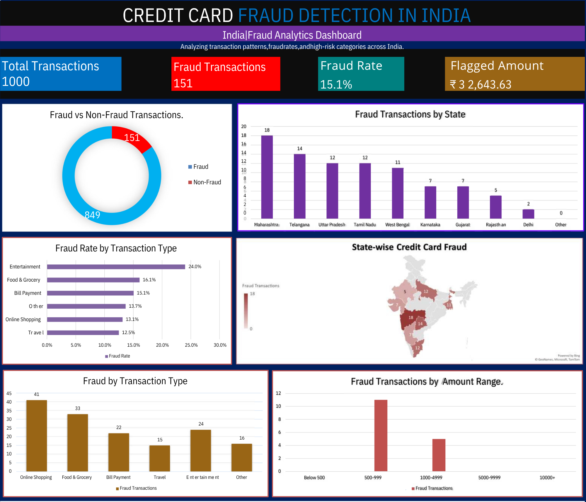

# Credit Card Fraud Detection in India

## Project Overview

An Excel dashboard project focused on analyzing credit card transactions and identifying potential fraud patterns in India.

## Dashboard Preview

## Tools Used

- Microsoft Excel
- Pivot Tables
- Excel Formulas
- Charts and Data Visualization

## Key Performance Indicators (KPIs)

- Total Transactions
- Fraudulent Transactions
- Fraud Rate
- Total Fraudulent Transaction Amount

## Analysis Performed

- Fraud vs. Non-Fraud Transactions
- State-wise Fraud Analysis
- Fraud by Transaction Type
- Fraud Rate by Transaction Type
- Fraud by Transaction Amount Range

## Key Insights

- **Highest Fraud Rate:** Entertainment — 24%.
- **Highest Fraud Count:** Online Shopping — 41 cases.
- **Lowest Fraud Rate:** Travel — 12.5%.
- **Fraud by Amount Range:** The 500–999 and 1,000–4,999 ranges have the most fraud cases.

## Key Insights Image

## Project Files

- `Credit_Card_Fraud_Analysis_in_India.xlsx` — Excel workbook.
- `dashboard_preview.png` — Dashboard preview image.
- `Key insights.png` — Key insights image.

## Disclaimer

This is a practice project. The dataset includes simulated fields, and the sample fraud rate should not be interpreted as a real-world fraud rate.
